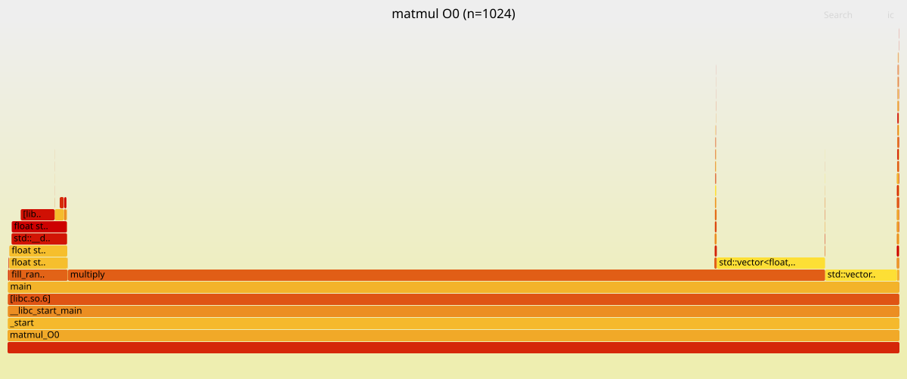
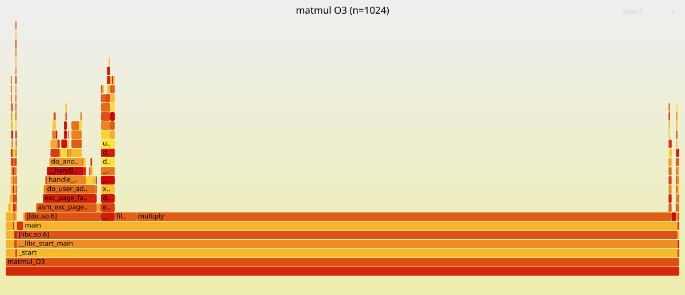
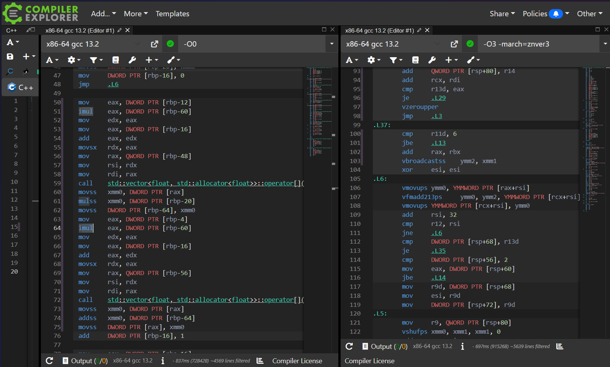
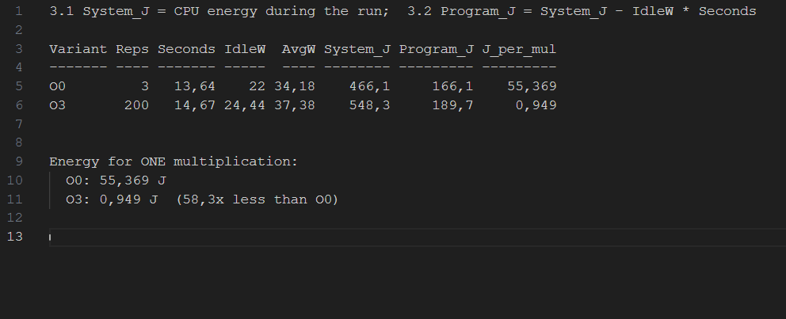

# Лабораторна робота №2. Performance Measurement and Analysis

**Профілювання, FlameGraph, статистика perf, енергоспоживання та оптимізація (SIMD/AVX2)**

## 1. Загальний опис

Мета: заміряти, як працює програма до і після оптимізації компілятором — час, лічильники процесора, кеш, асемблер і енергію.

Порівнюю дві версії однієї програми:
- `-O0` — без оптимізації (до)
- `-O3 -march=native` — оптимізація під мій процесор, з AVX2 і FMA (після)

Обидві зібрані з `-g -fno-omit-frame-pointer`, щоб perf бачив назви функцій і стек викликів.

**Програма** — множення двох матриць 1024×1024 типу `float` ([src/matmul.cpp](src/matmul.cpp)):
- `fill_random` — заповнює матриці випадковими числами (генератор `mt19937`, seed 42, тому дані завжди однакові)
- `multiply` — саме множення, три вкладені цикли в порядку i-k-j (внутрішній цикл іде по сусідніх елементах пам'яті)
- `checksum` — сума елементів результату, щоб перевірити, що O0 і O3 рахують одне й те саме
- `main` — запускає множення `reps` разів і друкує час і швидкість у GFLOPS

**Середовище:**
- AMD Ryzen 7 7735HS (Zen 3+, 8 ядер, AVX2 + FMA), 16 ГБ RAM
- Windows 11 + WSL2 (Ubuntu 24.04)
- g++ 13.3, perf 6.8, [FlameGraph](https://github.com/brendangregg/FlameGraph)

Особливості WSL:
- лічильники процесора для perf працюють
- `LLC-loads` показує `not supported` — на процесорах AMD perf ці події не підтримує
- лічильника енергії в WSL немає, тому енергію беру з Windows (`Energy Meter`, це ті самі RAPL-лічильники AMD)

## 2. Як запустити

В Ubuntu (WSL):

```bash
./scripts/perf_setup.sh       # дозволи для perf
./scripts/build.sh            # збірка O0 і O3
./scripts/01_flamegraph.sh    # п.1, 4.3
./scripts/02_stats.sh         # п.2, 4.2
./scripts/04_asm.sh           # п.4.1
```

У PowerShell:

```powershell
powershell -ExecutionPolicy Bypass -File scripts\03_energy.ps1 -Variants O0,O3 -Repeats 1    # п.3, 4.4
```

Що робить кожен скрипт — у [SCRIPTS.md](SCRIPTS.md). Повні виводи лежать у папці [results/](results).

---

## 3. Порівняльна таблиця (до і після оптимізації)

| Метрика | `-O0` | `-O3 -march=native` | Зміна |
| :--- | ---: | ---: | :--- |
| **Час множення** (вимірює програма) | 3.751 с | 0.060 с | **↓ 62.5x** (швидше на 98.4 %) |
| **Швидкість** | 0.57 GFLOPS | 36.04 GFLOPS | **↑ 63x** |
| **User CPU time** (`time`) | 4.36 с | 0.07 с | **↓ 62x** (менше на 98.4 %) |
| **Інструкції** (instructions) | 59.09 млрд | 0.96 млрд | **↓ 61.6x** (менше на 98.4 %) |
| **Такти** (cycles) | 18.77 млрд | 0.34 млрд | **↓ 55.3x** (менше на 98.2 %) |
| **IPC** (інструкцій за такт) | 3.15 | 2.82 | ↓ трохи, але кожна інструкція робить 8 операцій |
| **Переходи** (branches) | 5.54 млрд | 0.15 млрд | **↓ 36.8x** (менше на 97.3 %) |
| **Branch misses** | 4.09 млн (0.07 %) | 1.97 млн (1.31 %) | ↓ 2.1x за кількістю |
| **Звернення до L1** (L1-dcache-loads) | 24.28 млрд | 0.63 млрд | **↓ 38.4x** (менше на 97.4 %) |
| **Промахи L1** (L1-dcache-load-misses) | 74.6 млн | 68.5 млн | ~ 1.09x (майже без змін) |
| **Відсоток промахів L1** | 0.31 % | 10.84 % | ↑ 35x (див. пояснення в 4.2) |
| **Пам'ять** (Max RSS) | 15 744 КБ | 15 488 КБ | ~ 1.00x (однакова) |
| **Minor page faults** | 3219 | 3211 | ~ 1.00x (однакові) |
| **Потужність CPU під час роботи** | 34.18 Вт | 37.38 Вт | ↑ на 9 % |
| **Енергія системи на 1 множення** | 155.4 Дж | 2.74 Дж | **↓ 56.7x** (економія 98.2 %) |
| **Енергія програми на 1 множення** | 55.37 Дж | 0.95 Дж | **↓ 58.3x** (економія 98.3 %) |

Джерела: [time_O0.txt](results/time_O0.txt), [time_O3.txt](results/time_O3.txt), [perf_stat_O0.txt](results/perf_stat_O0.txt), [perf_stat_O3.txt](results/perf_stat_O3.txt), [energy_report.txt](results/energy_report.txt).

---

## 4. FlameGraph (пункти 1 та 4.3)

Будується так:

```bash
perf record -F 4999 -g -o results/perf_O0.data build/matmul_O0 1024 1
perf script -i results/perf_O0.data > results/out_O0.perf
/opt/FlameGraph/stackcollapse-perf.pl results/out_O0.perf > results/out_O0.folded
/opt/FlameGraph/flamegraph.pl results/out_O0.folded > results/flamegraph_O0.svg
```

1. `perf record` 4999 разів за секунду записує, яка функція зараз виконується (`-g` — разом зі стеком викликів)
2. `perf script` переводить запис у текст
3. `stackcollapse-perf.pl` згортає кожен стек в один рядок
4. `flamegraph.pl` малює SVG

Як читати: ширина блоку — скільки часу програма провела у функції, по вертикалі — хто кого викликає (знизу `main`, над ним функції, які він викликає).

### 4.1. До оптимізації (`-O0`)



- `multiply` займає **~85 %** часу — головне вузьке місце
- над нею два блоки `operator[]` (**12.1 % + 8.0 % ≈ 20 %**) — без оптимізації кожне звертання до елемента вектора `c[i*n+j]` це окремий виклик функції через `call`/`ret`
- збоку вузька вежа `fill_random` (**~6.6 %**) — генерація випадкових чисел через `uniform_real_distribution` і `mt19937`

`perf report` ([perf_report_O0.txt](results/perf_report_O0.txt)) показує те саме: `multiply` 72.4 %, `operator[] const` 11.9 %, `operator[]` 8.3 %.

### 4.2. Після оптимізації (`-O3`)



- **блоків `operator[]` немає** — компілятор вбудував їх (inlining) прямо в цикл
- `multiply` займає **~79 %** — але вся програма тепер працює в 62 рази менше часу
- **стали видні функції ядра** (`asm_exc_page_fault` ~9 %) — це перше звертання до нової пам'яті (page faults). Їх стільки ж, скільки в O0, але множення стало таким швидким, що їхня частка помітно зросла
- `fill_random` ~3 %, `checksum` ~1 %

`perf report` ([perf_report_O3.txt](results/perf_report_O3.txt)): `multiply [clone .isra.0]` 79.5 %, далі `fill_random` 2.7 % і функції ядра (`clear_page_erms` 2.3 %).

---

## 5. Статистика (пункт 2)

### 5.1. `/usr/bin/time --verbose` ([time_O0.txt](results/time_O0.txt))

- User time 4.36 с, System time 0.01 с — програма весь час рахує сама, системних викликів майже немає
- CPU ~100 % — працює одне ядро, програма однопотокова
- Max RSS 15.7 МБ — три матриці по 1024×1024×4 байти = 3 × 4 МБ, плюс сама програма
- 3219 minor page faults — ядро виділяє пам'ять сторінками по 4 КБ, 12 МБ / 4 КБ ≈ 3000 сторінок

### 5.2. `perf stat -d` ([perf_stat_O0.txt](results/perf_stat_O0.txt))

- 59 млрд інструкцій за 18.8 млрд тактів → IPC 3.15, процесор виконує ~3 інструкції за такт
- branch-misses 0.07 % — цикли дуже передбачувані
- L1 misses 0.31 % — дані майже завжди є в кеші, бо внутрішній цикл іде по пам'яті підряд
- LLC-loads — `not supported` (особливість AMD)

### 5.3. `perf record` + `perf report` ([perf_report_O0.txt](results/perf_report_O0.txt))

- `multiply` 72.4 % і `operator[]` ~20 % — майже весь час іде на цикл множення і виклики доступу до вектора

---

## 6. Асемблер і AVX2 (пункти 4.1 та 4.1.1)

Асемблер дістає скрипт [04_asm.sh](scripts/04_asm.sh) через `objdump` ([asm_multiply_O0.s](results/asm_multiply_O0.s), [asm_multiply_O3.s](results/asm_multiply_O3.s)), а також порівняння є на Compiler Explorer (godbolt) — посилання в [godbolt_link.txt](results/godbolt_link.txt).



### 6.1. До оптимізації (`-O0`): стек і скалярні інструкції

Внутрішній цикл `c[i*n+j] += aik * b[k*n+j]`:

```asm
mov     rax, QWORD PTR [rbp-0x30]       ; адреса вектора b зі стеку
call    vector<float>::operator[]       ; виклик функції, щоб дістати b[k*n+j]
movss   xmm0, DWORD PTR [rax]           ; завантажити ОДНЕ число float
mulss   xmm0, DWORD PTR [rbp-0x4]       ; помножити на aik (лежить у стеку)
movss   DWORD PTR [rbp-0x40], xmm0      ; зберегти проміжний результат у стек
...
call    vector<float>::operator[]       ; ще один виклик, щоб дістати c[i*n+j]
movss   xmm0, DWORD PTR [rax]
addss   xmm0, DWORD PTR [rbp-0x40]      ; додати ОДНЕ число
movss   DWORD PTR [rax], xmm0           ; записати ОДИН результат
add     DWORD PTR [rbp-0x8], 0x1        ; j++ (лічильник теж у пам'яті)
```

- усі змінні (`i`, `j`, `k`, `aik`) лежать у стеку `[rbp-...]`, а не в регістрах
- на кожен елемент — два виклики `operator[]`
- `mulss` / `addss` — скалярні інструкції, обробляють **одне** число за раз

### 6.2. Після оптимізації (`-O3 -march=native`): SIMD / AVX2 / FMA

```asm
vbroadcastss ymm2, xmm1                       ; aik копіюється у всі 8 місць регістра ymm2
.L6:                                          ; головний векторний цикл
vmovups      ymm0, YMMWORD PTR [rax+rsi]      ; завантажити 8 чисел з рядка b
vfmadd213ps  ymm0, ymm2, YMMWORD PTR [rcx+rsi] ; ymm0 = b * aik + c  для 8 чисел одразу
vmovups      YMMWORD PTR [rcx+rsi], ymm0      ; записати 8 результатів у c
add          rsi, 32                          ; крок 32 байти = 8 float
cmp          r12, rsi
jne          .L6
```

Компілятор сам підтвердив векторизацію ([O3_vectorization_report.txt](results/O3_vectorization_report.txt)):

```
src/matmul.cpp:24:31: optimized: loop vectorized using 32 byte vectors
```

Підрахунок інструкцій у `multiply` ([asm_summary.txt](results/asm_summary.txt)):

| | O0 | O3 |
| :--- | ---: | ---: |
| виклики `call` | 4 | 1 |
| скалярні операції (`...ss`, 1 float) | 9 | 13 |
| векторні операції на `ymm` (8 float) | 0 | 4 |
| FMA (`vfmadd...`) | 0 | 6 |

У O3 інструкцій у функції більше (180 проти 86), бо компілятор додає окремі шматки коду для «хвостів» і перевірок, але виконується лише короткий векторний цикл `.L6`.

### 6.3. Що тут від AVX (пункт 4.1.1)

1. **Регістри `ymm` по 256 біт** — вміщують 8 чисел `float` по 32 біти. Крок циклу 32 байти (`add rsi, 32`), тому ітерацій у 8 разів менше.
2. **FMA (`vfmadd213ps`)** — Fused Multiply-Add: множення і додавання `a × b + c` однією інструкцією, для 8 пар чисел одночасно.
3. **`vbroadcastss`** — розмножує одне число (`aik`) на весь регістр, щоб множити його на 8 елементів рядка `b`.
4. **Префікс `v` (формат VEX)** — трьохоперандні інструкції: результат можна записати в окремий регістр без зайвого копіювання.
5. **`-march=native`** дозволяє компілятору використати AVX2 і FMA, бо мій процесор їх підтримує. Без цього флагу компілятор використав би тільки SSE (`xmm`, 4 числа).

Це і є SIMD (Single Instruction, Multiple Data): одна інструкція обробляє одразу 8 чисел.

---

## 7. Порівняння статистики (пункт 4.2)

- **у 62 рази швидше**, бо **інструкцій у 62 рази менше**: зникли виклики `operator[]`, змінні перейшли в регістри, а кожна векторна інструкція робить 8 множень + 8 додавань
- **IPC трохи впав** (3.15 → 2.82): векторні інструкції «важчі» і програма тепер більше впирається в пам'ять, але кожна інструкція робить у 8–16 разів більше роботи
- **branches у 37 разів менше**: один прохід циклу обробляє 8 елементів замість одного
- **відсоток промахів L1 виріс** (0.31 % → 10.84 %), хоча **абсолютна кількість промахів майже та сама** (74.6 млн → 68.5 млн). У O0 було 24 млрд звернень до L1, більшість з них — до змінних у стеку, які завжди в кеші. У O3 ці звернення зникли (змінні в регістрах), тож залишились майже лише звернення до матриць — тому відсоток зріс, а самих промахів не стало більше
- **пам'ять і page faults однакові** — даних стільки ж (ті самі три матриці)

---

## 8. Енергоспоживання (пункти 3 та 4.4)

### 8.1. Методика

Скрипт [03_energy.ps1](scripts/03_energy.ps1) читає лічильник `\Energy Meter(rapl_package0_pkg)\Energy` — енергія всього пакета процесора (аналог `perf stat -e power/energy-pkg/`). Лічильник рахує в пВт·год, тому в джоулі: `× 3600 / 10^12`.

Модель вимірювання — **віднімання простою** (idle baseline subtraction):
1. 10 секунд міряю простій → потужність простою $P_{idle}$
2. запускаю програму і міряю енергію за час її роботи $T$
3. **3.1 — енергія системи:** $E_{sys} = P_{load} \times T$ (скільки спожив процесор за цей час)
4. **3.2 — енергія програми:** $E_{prog} = E_{sys} - P_{idle} \times T = (P_{load} - P_{idle}) \times T$

O0 запускався 3 рази, O3 — 200 разів, щоб кожен замір тривав ~13–15 с і був стабільним. Тому порівнюю енергію **на одне множення**. Для таблиці кожен варіант міряв один раз (`-Repeats 1`); за замовчуванням скрипт робить 3 заміри і бере медіану, бо фонові програми Windows дають шум.



| | O0 | O3 |
| :--- | ---: | ---: |
| Повторів множення | 3 | 200 |
| Час заміру $T$ | 13.64 с | 14.67 с |
| Простій $P_{idle}$ | 22.0 Вт | 24.4 Вт |
| Під час роботи $P_{load}$ | 34.2 Вт | 37.4 Вт |
| **3.1** Енергія системи $E_{sys}$ | 466.1 Дж | 548.3 Дж |
| **3.2** Енергія програми $E_{prog}$ | 166.1 Дж | 189.7 Дж |
| **Енергія програми на 1 множення** | **55.37 Дж** | **0.949 Дж** |

### 8.2. Енергія після оптимізації (пункт 4.4)

Потужність під час роботи майже однакова (34.2 Вт проти 37.4 Вт, O3 навіть трохи більше — векторні блоки AVX2 споживають більше). Але енергія = потужність × час, а O3 закінчує роботу в 62 рази швидше. Тому на одне множення пішло **в 58.3 рази менше енергії** (економія 98.3 %).

Це принцип **Race-to-Sleep (Race-to-Halt)**: краще швидко виконати роботу на трохи більшій потужності і повернути процесор у режим простою, ніж довго працювати на трохи меншій.

---

## 9. Висновки

- FlameGraph і `perf report` одразу показали вузьке місце — функцію `multiply` і виклики `operator[]` у ній
- `-O3 -march=native` прибрав виклики (inlining), переніс змінні в регістри і векторизував цикл під AVX2 + FMA — 8 чисел за інструкцію
- результат: **у 62 рази швидше**, **у 62 рази менше інструкцій**, **у 58 разів менше енергії** на одне множення при тій самій пам'яті

## Файли

```
src/        програма (matmul.cpp) і функція для godbolt
scripts/    скрипти для кожного пункту
results/    FlameGraph, виводи time / perf stat / perf report, асемблер, заміри енергії
assets/     скріншоти godbolt і звіту енергії
SCRIPTS.md  опис скриптів
```
